# tg_3d_modelling

Parametric 3D models (OpenSCAD) for 3D printing, built from one shared library of reusable parts. Every model has
all its settings at the top and comes with a configurator that runs in the browser: change the settings, look at
the result in 3D, download the STL. Nothing to install.

**Online configurators: [tamaygz.github.io/tg_3d_modelling](https://tamaygz.github.io/tg_3d_modelling/)** ·
[releases](https://github.com/tamaygz/tg_3d_modelling/releases) (each release links every configurator and its sources) ·
[licence: CC BY-NC-SA 4.0](LICENSE) (free for personal use and remixes, no commercial use)

## What it can do

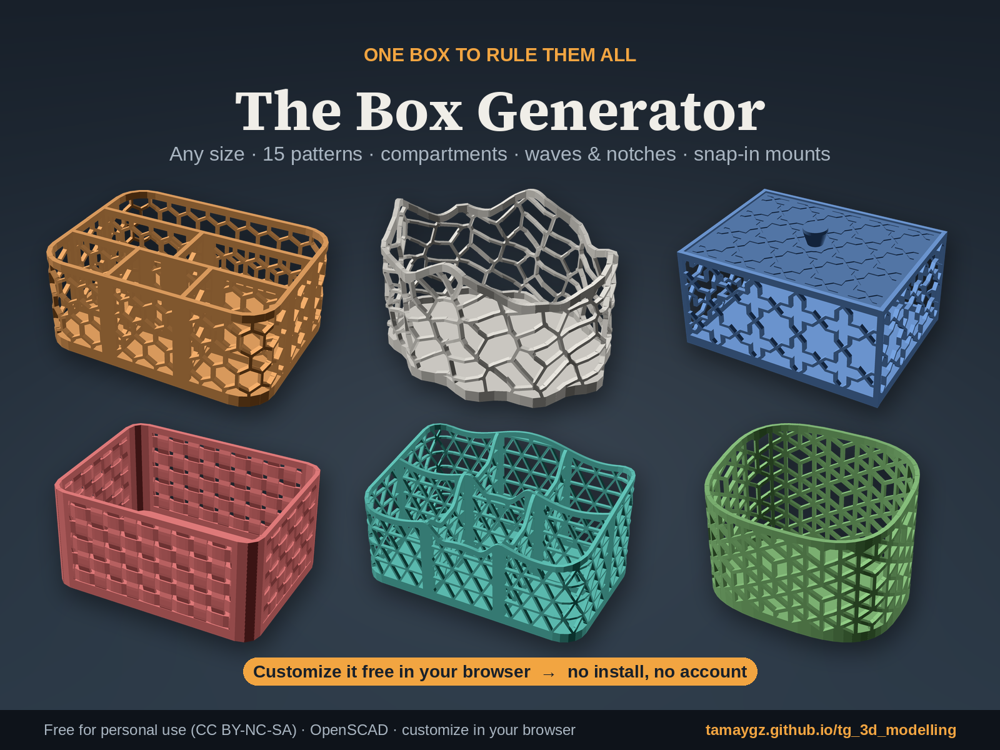

| | |
|---|---|
| 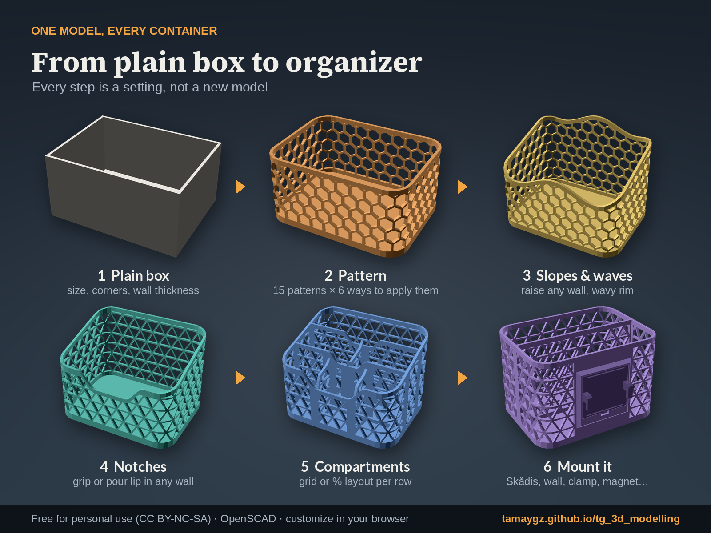 | 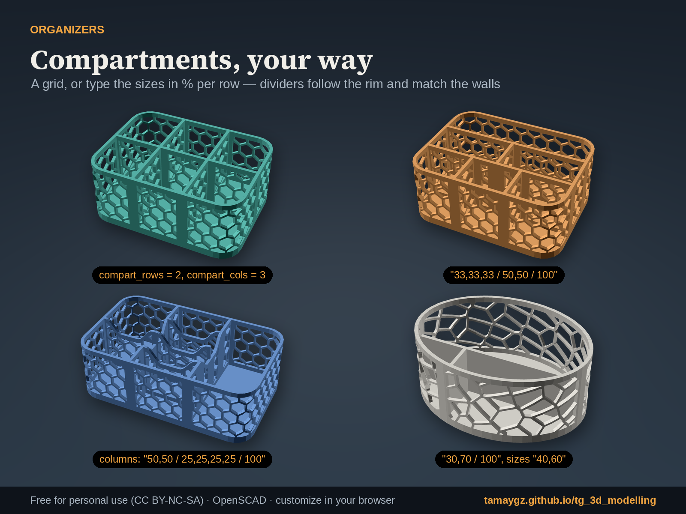 |
| 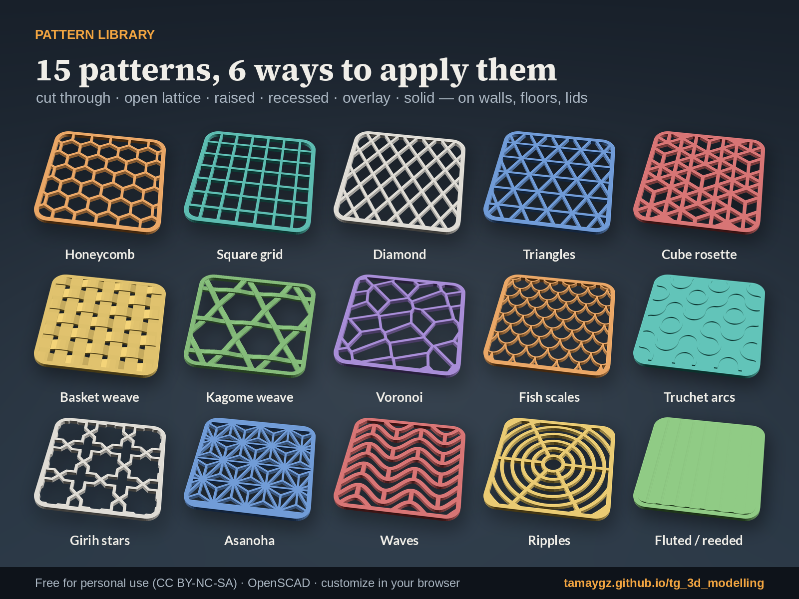 | 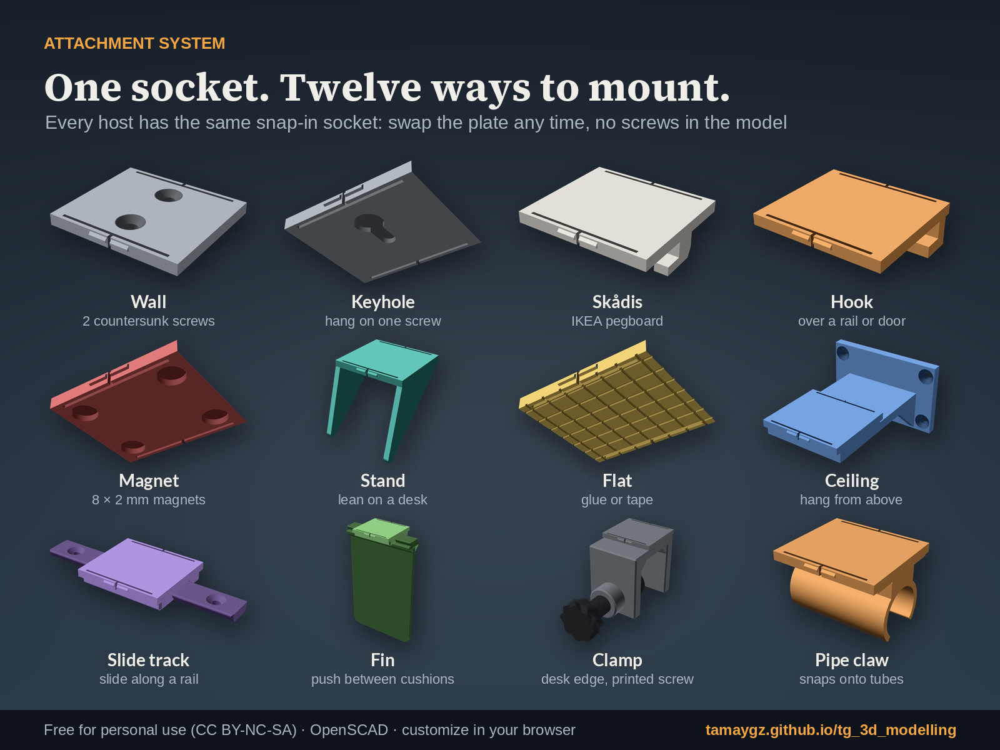 |
| 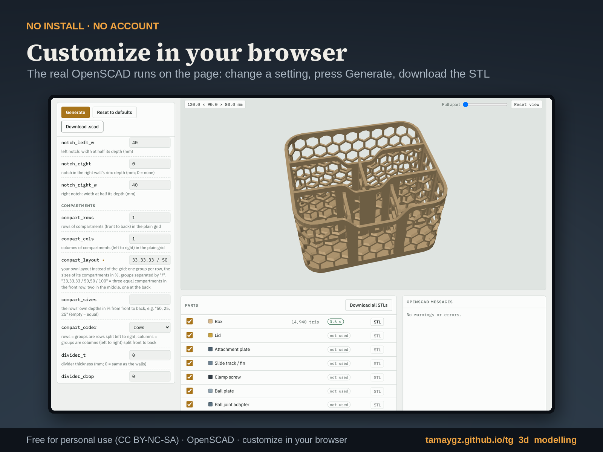 | 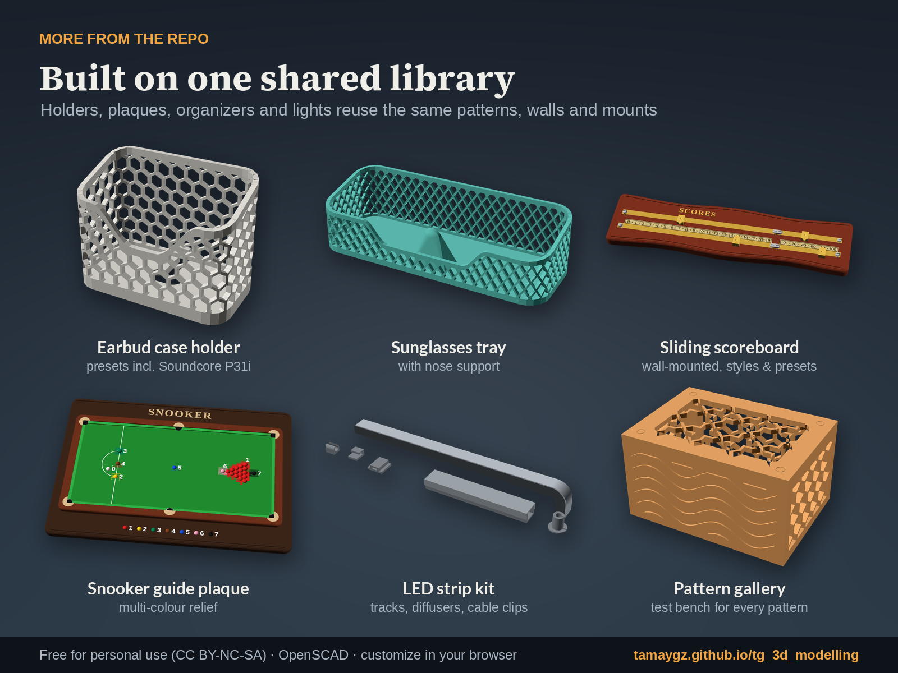 |

Pictures and the MakerWorld listing plan: [`marketing/`](marketing) (rebuilt from the models with
`python3 tools/make_marketing.py`).

## Projects

| | |
|---|---|
| [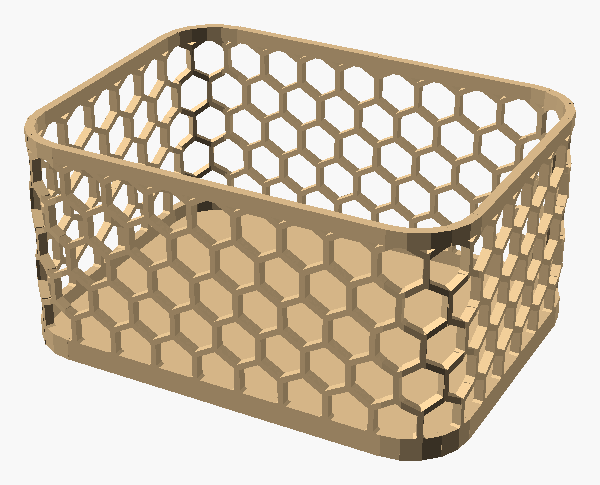](projects/custombox) | **[Custom box](projects/custombox)**<br>Any container from square and modern to round and flowing: outline, corners, sloped, wavy and notched rim, compartments (a grid or your own % layout), patterned walls, floor and lid, inset lid, mounting in the back wall or a fin underneath<br>[open the configurator](https://tamaygz.github.io/tg_3d_modelling/custombox) · [source](projects/custombox/custombox.scad) · [print files](projects/custombox/custombox_print) |
| [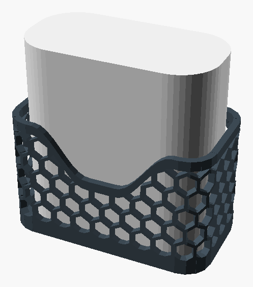](projects/earbuds) | **[Earbuds holder](projects/earbuds)**<br>Dock for an earbuds charging case: presets (Soundcore P31i, AirPods, Galaxy Buds, Sony, Bose, Pixel, Nothing), cable opening or plug dock, grip cut-out<br>[open the configurator](https://tamaygz.github.io/tg_3d_modelling/earbuds) · [source](projects/earbuds/earbuds.scad) · [print files](projects/earbuds/earbuds_print) |
| [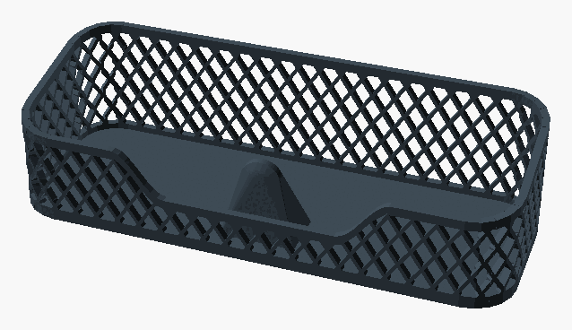](projects/sunglasses) | **[Sunglasses holder](projects/sunglasses)**<br>Tray for folded glasses with a nose support, grip cut-out and patterned walls<br>[open the configurator](https://tamaygz.github.io/tg_3d_modelling/sunglasses) · [source](projects/sunglasses/sunglasses.scad) · [print files](projects/sunglasses/sunglasses_print) |
| [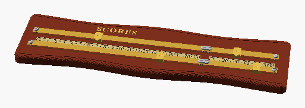](projects/scoreboard) | **[Scoreboard](projects/scoreboard)**<br>Wall scoreboard with sliding marker pins: players, score range, steps, five style presets<br>[open the configurator](https://tamaygz.github.io/tg_3d_modelling/scoreboard) · [source](projects/scoreboard/scoreboard.scad) · [print files](projects/scoreboard/scoreboard_print) |
| [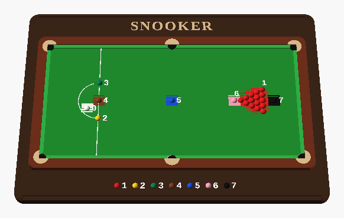](projects/snooker_guide) | **[Snooker setup guide](projects/snooker_guide)**<br>Multi-colour relief plaque of the snooker table, ball positions and points<br>[open the configurator](https://tamaygz.github.io/tg_3d_modelling/snooker_guide) · [source](projects/snooker_guide/snooker_guide.scad) · [print files](projects/snooker_guide/snooker_guide_print) |
| [](projects/bolavuit_logo) | **[Bola Vuit logo](projects/bolavuit_logo)**<br>Two-colour logo plaque: exact from the SVG, or rebuilt from adjustable elements with your own text<br>[open the configurator](https://tamaygz.github.io/tg_3d_modelling/bolavuit_logo) · [source](projects/bolavuit_logo/bolavuit_logo.scad) · [print files](projects/bolavuit_logo/bolavuit_logo_print) |
| [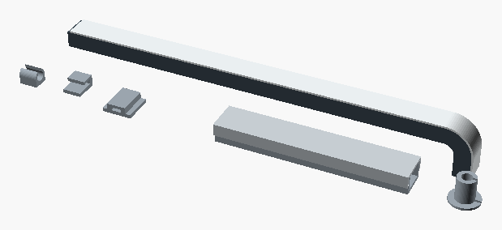](projects/led_kit) | **[LED kit](projects/led_kit)**<br>LED strip tracks, diffusers, corners, joiners, end caps and cable parts<br>[open the configurator](https://tamaygz.github.io/tg_3d_modelling/led_kit) · [source](projects/led_kit/led_kit.scad) · [print files](projects/led_kit/led_kit_print) |
| [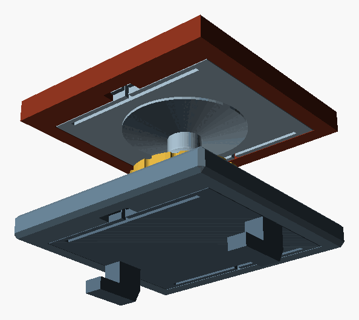](projects/attachments) | **[Attachments](projects/attachments)**<br>Every snap-in mounting plate, the slide track, the fin and the ball joint, with a test coupon: print this first<br>[open the configurator](https://tamaygz.github.io/tg_3d_modelling/attachments) · [source](projects/attachments/attachments.scad) · [print files](projects/attachments/attachments_print) |
| [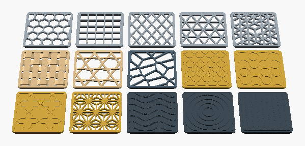](projects/pattern_gallery) | **[Pattern gallery](projects/pattern_gallery)**<br>Catalogue and test bench of the 12 library patterns in every application mode<br>[open the configurator](https://tamaygz.github.io/tg_3d_modelling/pattern_gallery) · [source](projects/pattern_gallery/pattern_gallery.scad) · [print files](projects/pattern_gallery/pattern_gallery_print) |

Each project folder holds the same things:

| File | What it is |
|---|---|
| `<name>.scad` | the model; all settings at the top, in OpenSCAD Customizer format |
| `README.md` | what it is, its settings, recipes and print notes, with pictures |
| `<name>_configurator.html` | the configurator as a single file: open it in a browser, no install |
| `<name>_print/` | print-ready files, oriented for the bed (STL, multi-colour 3MF) |
| `<name>.html` | 3D viewer of the default build |
| `<name>_log.md` | design log: decisions, fixes, print feedback, open questions |
| `tests.txt` | parameter variants that are built and checked automatically |
| `shots.txt`, `images/` | the pictures in the README and how to render them again |
| `<name>_parts/`, `<name>_<rev>.zip` | parts as modelled and a bundle with the library: built locally, not committed |

## Library

[`lib/`](lib/README.md) holds everything the projects share. Projects only lay library parts out; anything
reusable is written there once.

| | |
|---|---|
| 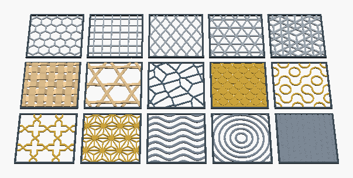 | **[Patterns](lib/README.md#patterns)**: 15 patterns (lattices, cube rosettes, real weaves, Voronoi, scales, Truchet, Girih, asanoha, waves, ripples, fluted ribs) that can be cut through, raised, engraved, used as an open lattice or as a lining on any flat surface |
| 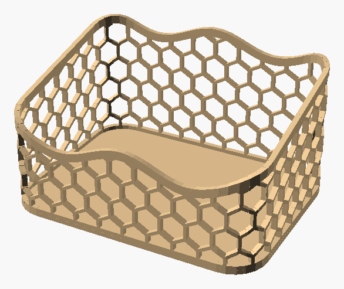 | **[Shells](lib/README.md#shells) and [containers](lib/README.md#containers)**: walls that follow any outline with a sloped or wavy rim, floors, lids, openings, grip cut-outs, mounting zones |
| 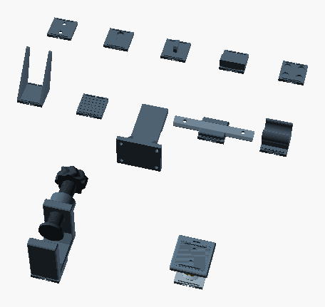 | **[Attachments](lib/README.md#attachment-plates)**: one socket, many snap-in plates (wall, keyhole, Skådis, hook, magnet, stand, glue, ceiling, slide track, fin) and an optional ball joint |

Also: plaque shapes and routed edges, rails and sliders, number scales, LED strip tracks, cable parts, logo
elements, fits and bundled fonts. See [`lib/README.md`](lib/README.md).

## Tools

| Command | What it does |
|---|---|
| `python3 tools/build.py <project> --test` | the one command after any change: rebuilds a project's outputs (parts, print files, bundle, configurator) and checks every variant in its `tests.txt`; `all` does every project |
| `python3 tools/make_screenshots.py <project> \| lib \| all` | renders the README pictures listed in `shots.txt` |
| `python3 tools/make_marketing.py [page]` | renders the marketing pictures in `marketing/images/` from the current models (see `marketing/makerworld.md`) |
| `python3 tools/make_configurator.py projects/<name>/<name>.scad` | only rebuilds the single-file configurator |
| `python3 tools/make_pages.py` | stages every project for the online configurator site (used by the workflow below) |
| `python3 tools/svg_to_scad.py art.svg out.scad --prefix XX` | converts SVG artwork into exact OpenSCAD polygons |
| `python3 tools/artfit.py overlay exported.svg reference.png out.png` | compares a model's 2D output with reference artwork |
| `python3 tools/prepare_font.py SRC.ttf lib/fonts/OUT.ttf --family NAME` | subsets and hints a font for `lib/fonts/` |
| `python3 tools/font_metrics.py` | regenerates the font width tables after adding a font |
| `bash setup_env.sh` / `./setup_env.ps1` | installs the build toolchain on Linux / the build helper on Windows |

`build.py` uses the OpenSCAD skill's `asm.py` (found under `~/.claude/skills`, or set `OSCAD_SCRIPTS`).
The setup scripts install helper v2.4.0 and an isolated Python environment. The Linux script uses `apt-get`
and requires permission to install packages. On Windows, install Git, Python and OpenSCAD first, then run:

```powershell
./setup_env.ps1
$env:PATH = 'C:\Program Files\OpenSCAD;C:\Program Files\Git\usr\bin;' + $env:PATH
$env:OSCAD_SCRIPTS = "$HOME\.claude\skills\openscad-skill\openscad\scripts"
& "$env:LOCALAPPDATA\tg_3d_modelling\build-venv\Scripts\python.exe" tools/build.py scoreboard --test
```

Adjust the paths if OpenSCAD or Git is installed elsewhere. On Linux, run builds with
`~/.local/share/tg_3d_modelling/build-venv/bin/python` after setup.

## Online configurators and releases

The configurators at [tamaygz.github.io/tg_3d_modelling](https://tamaygz.github.io/tg_3d_modelling/) are built by the manual workflow
**Web configurators and release** (`.github/workflows/configurators.yml`; Actions → Run workflow). It builds one
page per project with [web-openscad-editor](https://github.com/yawkat/web-openscad-editor), publishes them on
GitHub Pages and creates a [release](https://github.com/tamaygz/tg_3d_modelling/releases) whose notes link every
configurator and its sources, with an offline copy of the site attached. Each page contains the model, every
library file it includes and the fonts; OpenSCAD runs in the browser. Pick a **part** to show and export a single
printable piece. Run the workflow again after changes to publish them. One-time setup: Settings → Pages →
Source = **GitHub Actions**.

To try the site locally: `python3 tools/make_pages.py`, then in a web-openscad-editor checkout
`uv run python src/generate.py --config <repo>/build/pages-src/editor.toml --clean-urls --output site` and serve
`site/` with `python3 -m http.server`.

## Adding a project

1. Copy `projects/_template/` to `projects/<name>/` and rename its files to `<name>.*`.
2. Replace the model. Keep the layout: library includes, `part`, Customizer sections, `/* [Hidden] */` with derived
   values, the `parts` / `checks` / `report` tables, then 2D shapes, solids and the assembly.
3. Use the library first ([`lib/README.md`](lib/README.md)); move anything reusable you write into it.
4. List the parameter combinations worth checking in `tests.txt` and the pictures for the README in `shots.txt`.
5. Run `python3 tools/build.py <name> --test` and `python3 tools/make_screenshots.py <name>`, fill in the README and
   the log, and add the project to the table above and to `CLAUDE.md`. The workflow picks it up by itself.

## Conventions

- **Settings never stop the model without need.** Something that does not fit is reduced or left out with a
  `WARNING` in the render log (attachments pick a smaller plate, patterns that would fall apart are raised instead
  of cut). Only settings that cannot produce a printable part stop with a message that says what to change.
- **Printable as designed.** No supports where a 45° face or a bridge will do, snap fits bend 2% or less, cut-through
  patterns are tied into one network, every part is one watertight piece (the tests check this).
- **Library first, one way to do each thing.** Patterns, shells, containers, attachments, LED and cable parts,
  fonts and fits come from `lib/`; projects add only what is specific to them.

## Licence

[CC BY-NC-SA 4.0](LICENSE) © tamaygz: print, share and remix freely with credit; no commercial use (no selling files
or prints) without written permission; remixes under the same licence. Fonts in `lib/fonts/` keep their own
licence (SIL OFL 1.1); the Bola Vuit logo belongs to its owner and is not covered. Details in [`LICENSE`](LICENSE).
