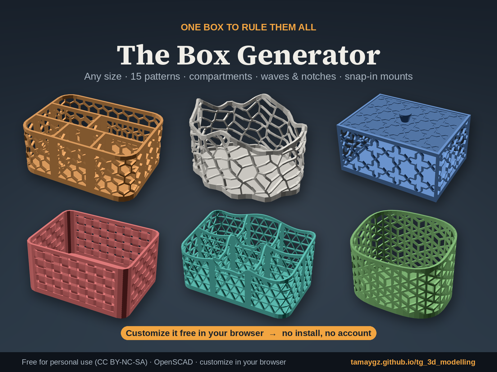
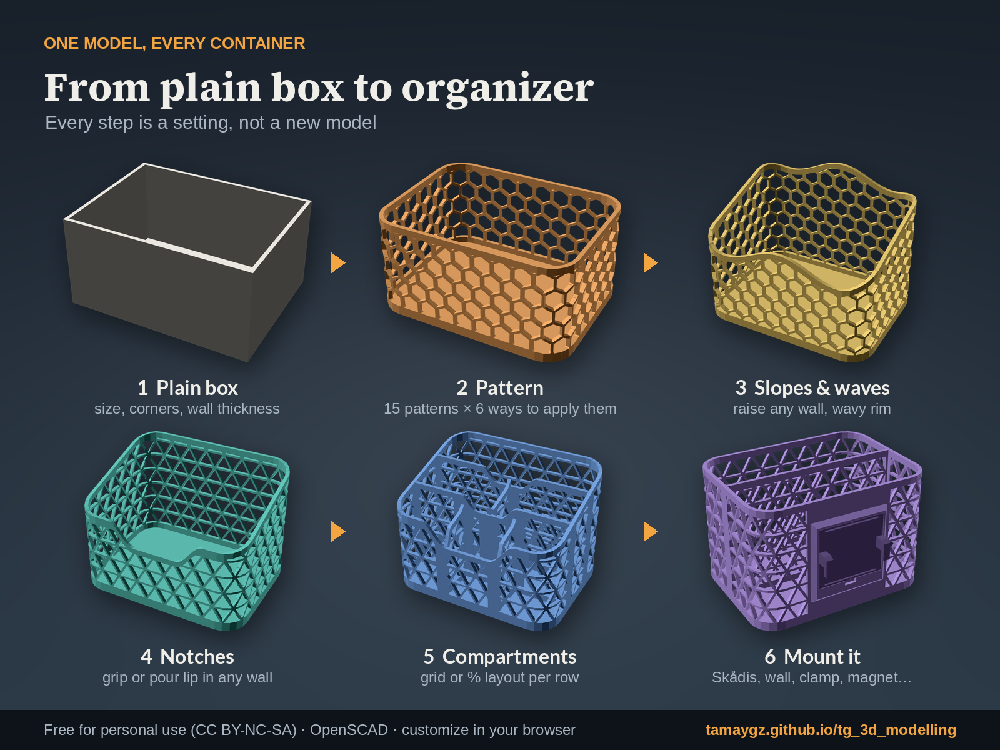
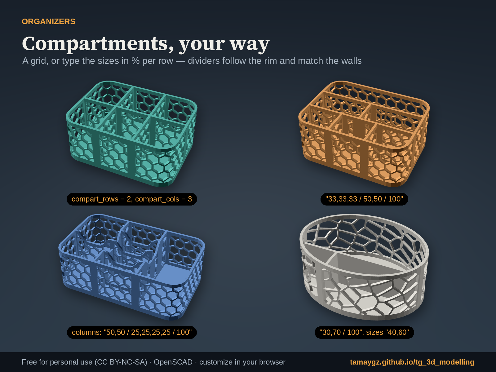
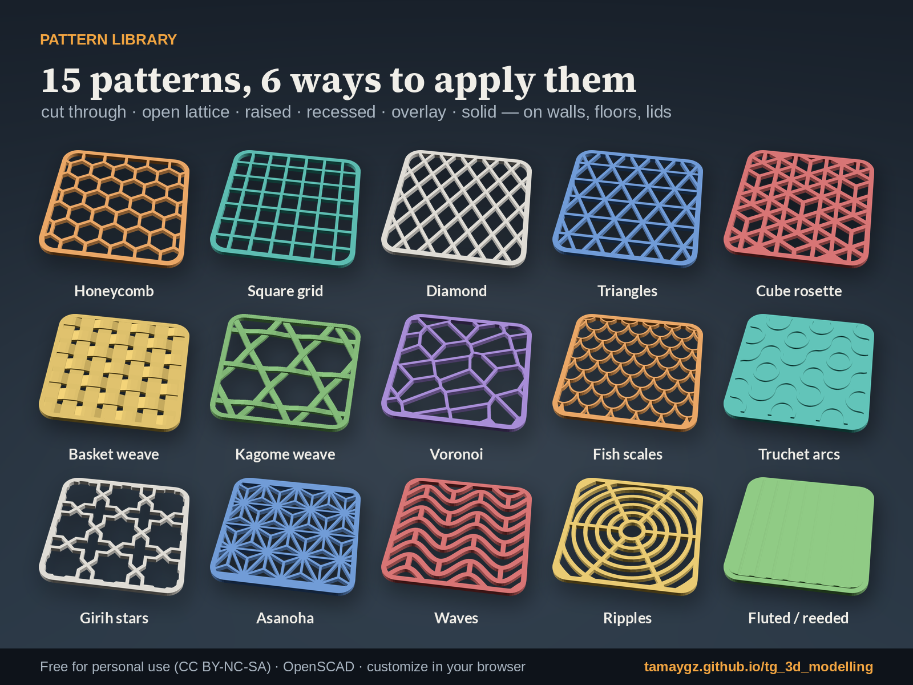
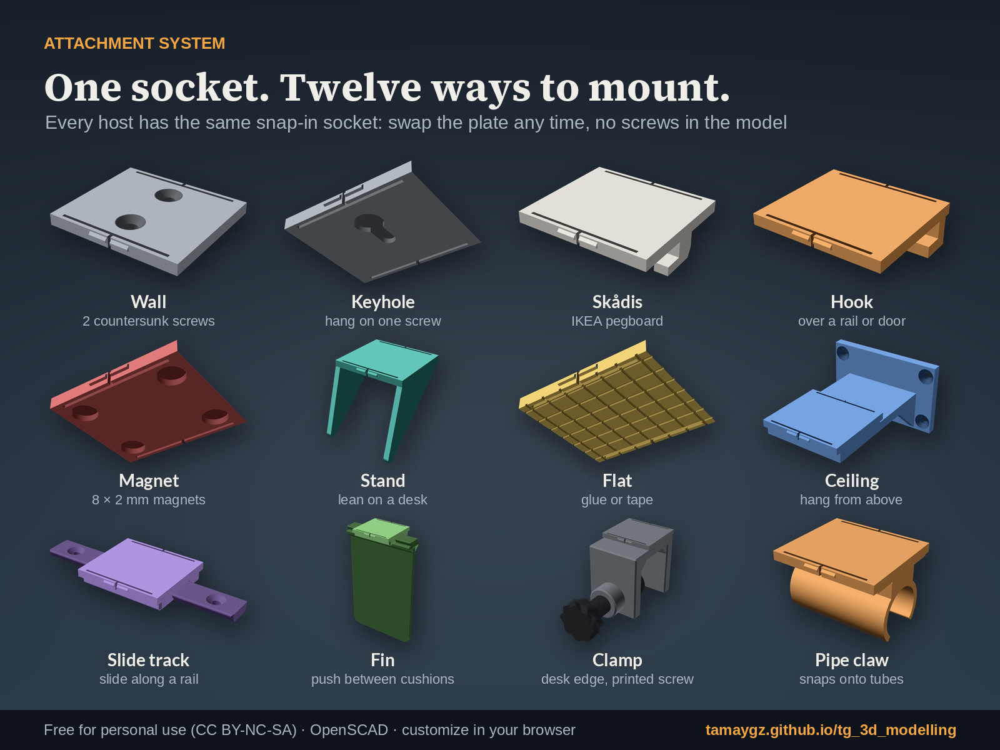
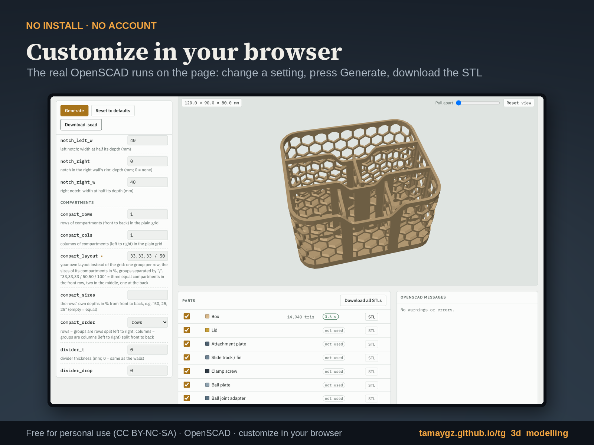

# Marketing

Pictures and texts for sharing the project (MakerWorld, Printables, social posts).

- [`makerworld.md`](makerworld.md): the MakerWorld listing plan: research on similar models, title, tags,
  picture order, a ready-to-paste description, print profiles, licence and a launch checklist.
- [`images/`](images): 1600 × 1200 (4:3) pictures, rendered from the current models by
  `python3 tools/make_marketing.py` (all) or `python3 tools/make_marketing.py <page>`
  (cover, evolution, compartments, patterns, attachments, configurator, family). Re-run it after a visible
  change to a model; the configurator page also needs Playwright.

| | |
|---|---|
|  |  |
|  |  |
|  |  |
|  | |

Licence of everything here: [CC BY-NC-SA 4.0](../LICENSE).
