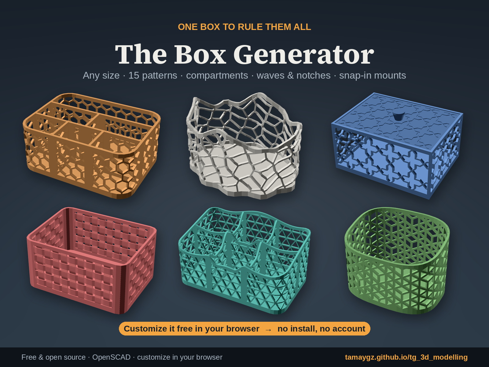
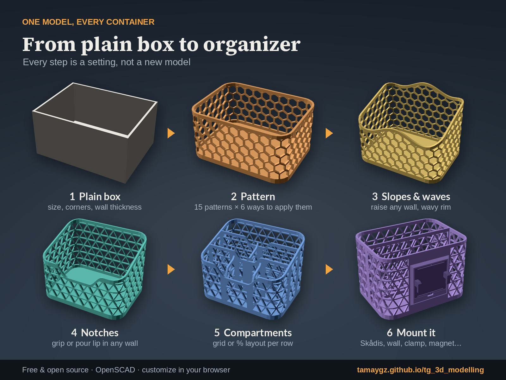
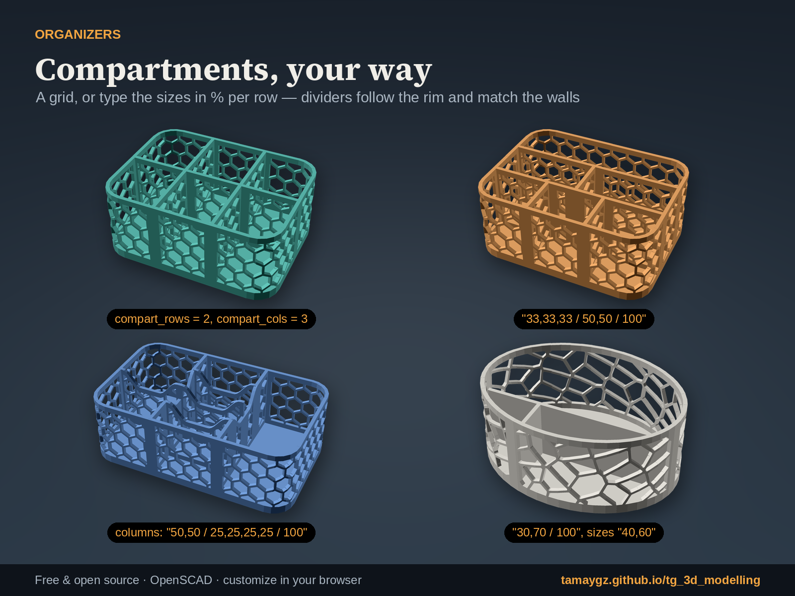
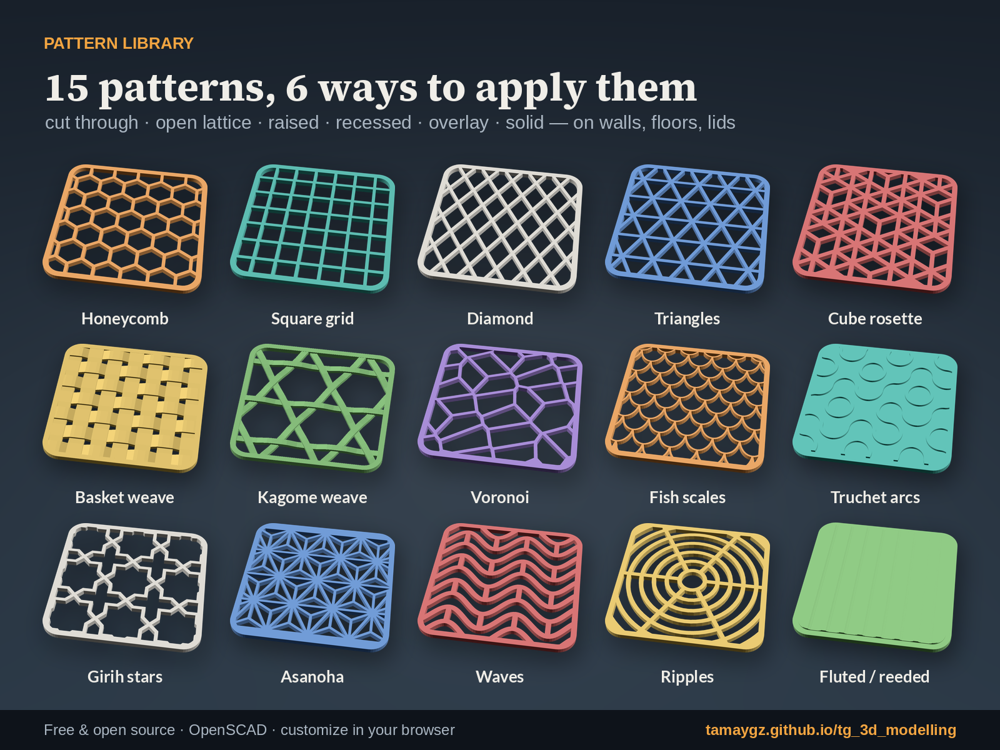
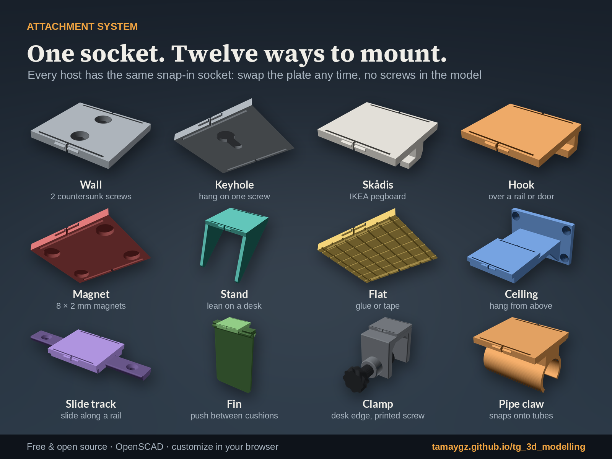
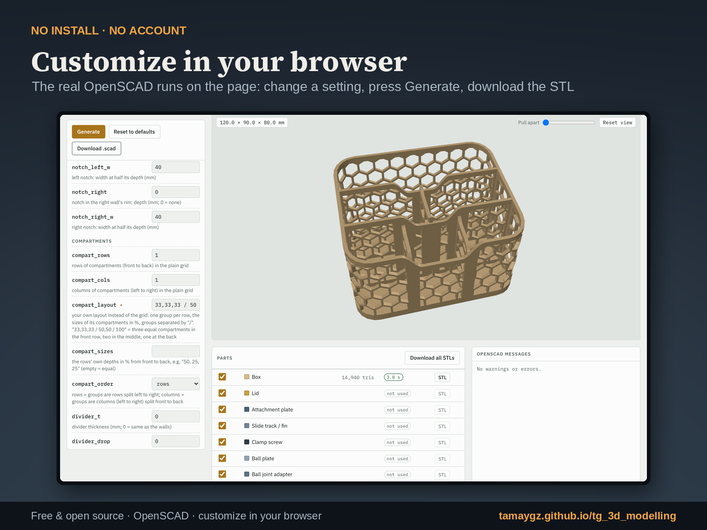

# MakerWorld listing: recommendations

Everything needed to post the **Custom box** ("The Box Generator") on MakerWorld so that people find it, understand
it in two seconds and try it. Pictures are in [`images/`](images); rebuild them after any model change with
`python3 tools/make_marketing.py` (they are rendered from the current models).

> Before posting: (1) **print two or three boxes and photograph them.** MakerWorld's featured-model guidelines
> and the community favour real print photos over renders; put one photo second in the gallery.
> (2) **Add a licence to the repository** (there is none yet, see [Licence](#licence)).

## 1. What is already out there (research, Nov 2026)

| Model | What it offers | How ours differs |
|---|---|---|
| [Simple parametric box generator](https://makerworld.com/en/models/2688081) | size, walls; outer size fixed | patterns, rims, compartments, mounts |
| [Parametric Box Generator](https://makerworld.com/en/models/2146936-parametric-box-generator) | rounded corners, optional dividers and lid (MakerWorld-exclusive licence) | free, open source, 15 patterns, % layouts |
| [Parametric storage box with customizable dividers](https://makerworld.com/en/models/1859912-parametric-storage-box-with-customizable-dividers) | print-in-place box, divider positions | dividers follow sloped / wavy rims, own patterns |
| [Customizable parametric box with dividers](https://makerworld.com/en/models/476274) | cell sizes, inner or outer size | per-row % layouts, rows-first or columns-first |
| [Parametric honeycomb box](https://www.makerworld.com/en/models/2249972) / [stackable](https://makerworld.com/en/models/2494879-parametric-honeycomb-box-stackable) | honeycomb walls and floor | 15 patterns × 6 ways to apply them, seamless round the corners |
| [Honeycomb storage box with compartments](https://makerworld.com/en/models/497259) | Honeycomb Storage Wall and Skådis connectors | Skådis plus 10 other snap-in mounts, swappable |
| [Customizable Box](https://www.makerworld.com/en/models/532138) (4.8 ★, 30 ratings) | size, lid icons, text | different niche (lid labels) |

The niche is crowded with "parametric box" listings that each do one thing (dividers, or honeycomb, or a lid).
**Our hook is "one model for every container"**: a plain bin, a woven basket, a wavy bowl and a desk organizer
with finger notches are all the same model. Lead with that, show the range in the first picture, and say "free,
in your browser" early: most competing listings need the MakerWorld customizer or OpenSCAD.

What the forums say about getting found
([1](https://forum.bambulab.com/t/how-can-i-improve-my-models-popularity/170107),
[2](https://forum.bambulab.com/t/getting-views-likes-and-downloads-on-makerworld-serious-question/122266),
[3](https://forum.bambulab.com/t/asking-for-advice-best-practice-for-new-model-uploads/259394),
[featured-model guidelines](https://wiki.bambulab.com/en/makerworld/tutorials/featured-model-guidelines)):

- The **cover picture** decides whether anyone clicks. It should show the range at a glance and stay readable as
  a small tile.
- **Short, keyword-first titles** rank better than long ones stuffed with buzzwords; tags should be few and exact.
- A thorough description with print settings and several finished prints builds trust and downloads.
- New models get a visibility boost: publish when the photos and print profiles are ready, then post in the
  community section and answer comments in the first days.
- The cover ratio is **4:3** ([forum](https://forum.bambulab.com/t/whats-the-correct-photo-size-aspect-ratio-for-makerworld/64061),
  [aspect ratios](https://forum.bambulab.com/t/aspect-ratios-for-images-best-sizes/110844)); all pictures here
  are 1600 × 1200.

## 2. Title

**Recommended:** `Parametric Box Generator – 15 Patterns, Compartments & Mounts`

Alternatives (pick one, keep it under ~60 characters):
- `Customizable Organizer Box – Patterns, Dividers, Skådis`
- `One Box Generator: Baskets, Bins & Organizers (Customizable)`
- `Honeycomb Basket & Organizer Box Generator – Parametric`

## 3. Tags

Use 10–12, all exact:

`parametric` · `customizable` · `box` · `storage box` · `organizer` · `basket` · `compartments` · `dividers` ·
`honeycomb` · `skadis` · `openscad` · `bin`

Category: the closest storage / organization category under Household (whatever MakerWorld currently calls it).

## 4. Pictures (in this order)

| # | File | Caption |
|---|---|---|
| 1 | [`01_cover.png`](images/01_cover.png) | One box to rule them all: every one of these is the same model |
| 2 | *your print photo* | Printed in PLA, 0.2 mm layers, no supports |
| 3 | [`02_evolution.png`](images/02_evolution.png) | From plain box to organizer: every step is a setting |
| 4 | [`03_compartments.png`](images/03_compartments.png) | Compartments: a grid, or type the sizes in % per row |
| 5 | [`04_patterns.png`](images/04_patterns.png) | 15 patterns, cut through, as a lattice, raised, recessed or as a lining |
| 6 | [`05_attachments.png`](images/05_attachments.png) | One socket, swappable plates: wall, Skådis, magnet, clamp, pipe… |
| 7 | [`06_configurator.png`](images/06_configurator.png) | Customize in your browser: no install, no account |
| 8 | [`07_family.png`](images/07_family.png) | More models built on the same library |
| 9+ | more print photos | a filled organizer on a desk; a basket on a Skådis board |

Mark renders as renders in their captions if MakerWorld asks for it; never present a render as a photo.

<p>
 
 
 
</p>

## 5. Description (ready to paste)

> **One box to rule them all.** A square bin, a woven basket, a wavy fruit bowl and a desk organizer with finger
> notches: they are all this one model. Pick a size and a look, download the STL, print. No supports.
>
> **🖥️ Customize it free in your browser – no install, no account:**
> **https://tamaygz.github.io/tg_3d_modelling/custombox**
> (the real OpenSCAD runs on the page; open source on GitHub: https://github.com/tamaygz/tg_3d_modelling)
>
> **What you can set**
> - **Size & shape:** any width, depth and height; box (round, chamfered or square corners), ellipse or squircle;
>   wavy sides for organic bowls.
> - **15 patterns:** honeycomb, square grid, diamond, triangles, cube rosette, basket weave, kagome weave,
>   Voronoi, fish scales, Truchet arcs, Girih stars, asanoha, waves, ripples, fluted – cut through, as an open
>   lattice, raised, recessed or as a lining. Patterns close seamlessly round the corners. Front and back can
>   have their own pattern.
> - **Compartments:** a grid (rows × columns) or your own layout in percent per row, e.g. `33,33,33 / 50,50 / 100`
>   = three in front, two in the middle, one long one at the back. Dividers match the walls, can be lower or
>   thinner, and get finger notches.
> - **Rim:** raise or lower any wall (sloped bins), waves along the rim, and a notch (grip or pouring lip) in any
>   wall.
> - **Lid:** an inset lid with a knob or finger hole.
> - **Mounting:** snap-in plates that you can swap any time: wall screws, keyhole, IKEA Skådis, hook, magnets
>   (8 × 2 mm), glue, ceiling, slide track, a fin to push between sofa cushions, a desk clamp with a printed
>   screw, or a pipe claw. Optional ball joint to tilt the box.
>
> **Printing**
> - PLA or PETG, 0.2 mm layers, 2–3 walls, 10–15 % infill. No supports: overhangs are kept at 45° or less.
> - The box prints upright; plates print as their files are oriented.
> - Settings that do not fit are reduced instead of failing (a smaller plate, fewer compartments), and the page
>   tells you what was changed.
>
> **Ready-made versions** in the print profiles below: honeycomb basket, 3 + 2 + 1 organizer, 2 × 3 desk
> organizer with notches, woven basket, wavy Voronoi bowl, Girih box with lid.
>
> Made with a shared, open library: the same patterns and mounts are used by an earbuds holder, a sunglasses
> tray, a scoreboard and more – see the GitHub repository. Feedback and print photos are very welcome!

## 6. Files and print profiles

MakerWorld's own Parametric Model Maker runs a **single** .scad file with its bundled libraries; it cannot load
our `lib/` folder (multi-file upload is only "on the roadmap",
[forum](https://forum.bambulab.com/t/parametric-model-maker-review-and-feedback/75758?page=2),
[unofficial docs](https://nelsonjchen.github.io/unofficial-makerworld-parametric-model-maker-openscad-docs/pmm-openscad-api/)).
So for now:

1. Upload **ready STLs / 3MF print profiles** of six presets (one profile each, named after the look), rendered
   with `build.py` or downloaded from the configurator:

   | Profile | Settings |
   |---|---|
   | Honeycomb basket | defaults |
   | Organizer 3 + 2 + 1 | `compart_layout = "33,33,33 / 50,50 / 100"; height = 50` |
   | Desk organizer 2 × 3 | `compart_rows = 2; compart_cols = 3; rise_back = 20; rim_wave_x_amp = 5; rim_wave_x_count = 1.5; divider_notch = 14; notch_front = 14; wall_pattern = "triangular_lattice"; width = 160; depth = 100` |
   | Woven basket | `corner_fill = "solid"; wall_pattern = "basket_weave"; wall_mode = "open_lattice"; corner_r = 10` |
   | Wavy Voronoi bowl | `shape = "ellipse"; side_wave = 2.5; side_wave_count = 10; wall_pattern = "voronoi"; rim_wave_x_amp = 6; rim_wave_y_amp = 6; rim_wave_x_count = 2; rim_wave_y_count = 2` |
   | Girih box with lid | `corners = "square"; corner_fill = "solid"; wall_pattern = "girih_star_cross"; wall_cell = 26; lid = "inset"; lid_grip = "knob"` |

2. Put the **browser configurator link** at the very top of the description (above) for everything else.
3. Optional, later: a flattened single-file `custombox_pmm.scad` (the model with its library files inlined) would
   make it work in MakerWorld's own customizer too, which gives the listing the "Customize" button and more
   visibility. That needs a small tool that inlines `include`/`use` files; ask for it when you want it.

Also add the separate attachment plates (S/M/L for each type) as a second listing or as extra files, linking back
here: "Mount your box anywhere".

## 7. Licence

The repository has no licence yet, which legally means "all rights reserved" and keeps people from remixing.
Common choices for printable models: **CC BY 4.0** (anyone may use and remix with credit) or **CC BY-SA 4.0**
(remixes must stay open); for the OpenSCAD code, **MIT**. The fonts in `lib/fonts` keep their own OFL /
Liberation licences. Pick the same licence on MakerWorld as in the repository.

## 8. Launch checklist

- [ ] Print 2–3 presets, photograph them in daylight on a plain background (one filled with things in use)
- [ ] Add a licence file to the repository and pick the same one on MakerWorld
- [ ] Run the web-configurator workflow so the live page has the newest version
- [ ] Upload: title, tags, pictures in the order above, description, six print profiles
- [ ] Post in the MakerWorld community section with the cover and the evolution picture
- [ ] Answer comments and add makes in the first week; update the listing when you add features
- [ ] Later: separate listings for the earbuds holder and the attachment plates, each linking to the others

## 9. Regenerating the pictures

```bash
python3 tools/make_marketing.py              # all 7 pictures
python3 tools/make_marketing.py cover        # one: cover, evolution, compartments, patterns, attachments, configurator, family
```
