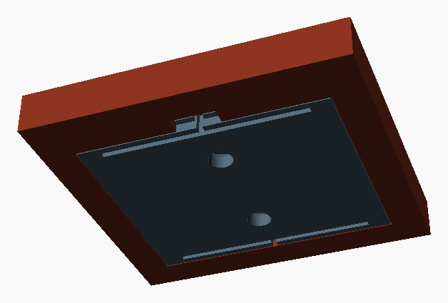
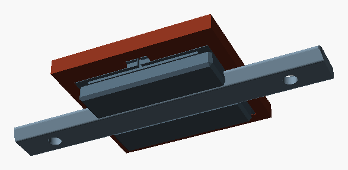
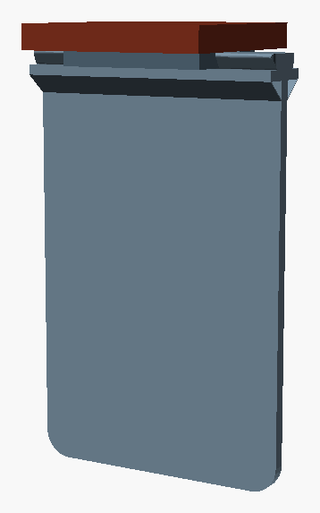
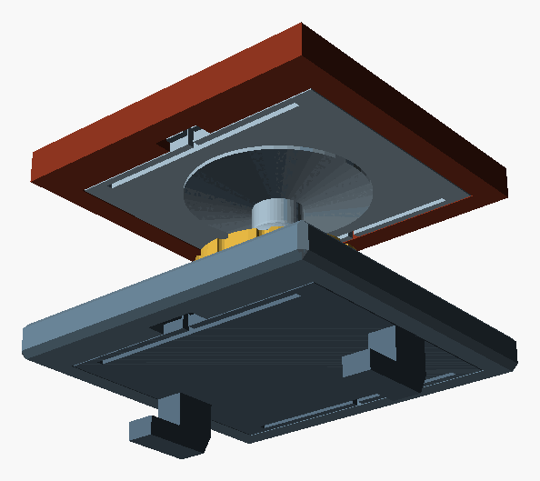
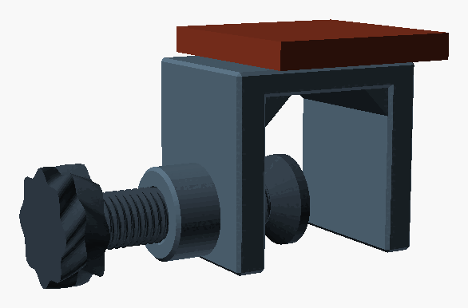
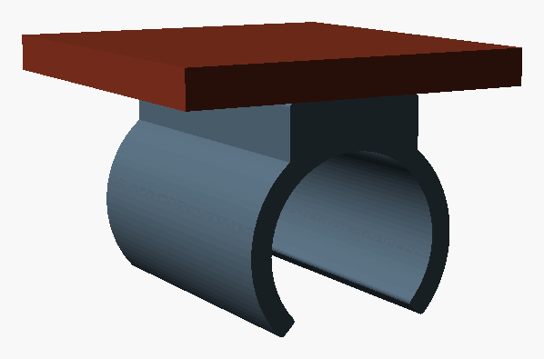

# Attachment plates

<table><tr><td align="center"> wall plate and test coupon</td><td align="center"> slide plate on its track</td><td align="center"> fin</td></tr><tr><td align="center"> ball joint with a Skådis plate</td></tr><tr><td align="center"> clamp with its printed screw</td><td align="center"> pipe claw</td></tr></table>

**[Open the online configurator](https://tamaygz.github.io/tg_3d_modelling/attachments)** · or open `attachments_configurator.html` from this folder · [model](attachments.scad) · [print files](attachments_print) · [design log](attachments_log.md)

Interchangeable mounting plates for every project in this repo, from [`lib/attach.scad`](../../lib/README.md#attachment-plates).
Any project with sockets in its back takes any of these plates.

**Print this first:** the test coupon has one socket, so you can check the snap fit on your printer before
printing a whole project. Open `attachments_configurator.html` to pick a type and size and download the STLs.
It is exactly as thin as a host may be (5.2 mm: 4.0 mm socket + 1.2 mm closed back, 4 mm rim), so it also
proves the minimum. Every type uses the same socket, so plates can be swapped at any time; the depth budget per
type (magnet 8 × 2, screw heads, keyhole) is in [lib/README.md](../../lib/README.md#attachment-plates).

| Setting | Options |
|---|---|
| `attach_type` | wall, keyhole, skadis, hook, magnet, stand, flat, roof |
| `attach_size` | S 30×30, M 45×40, L 60×50 mm |
| per type | screw and head size, magnet size, hook gap, stand angle and depth, roof reach / angle / flange depth |

How it fits: push the plate straight into the socket until it clicks. To remove it, put a flat screwdriver in the
notch below the plate and lever it out. If it is too stiff or too loose on your printer, change `SNAP_B` (bump
height, default 0.8 mm) in `lib/attach.scad`.

Files: `attachments.scad` (model), `attachments_print/` (coupon upside down, plate), `attachments_configurator.html`,
`attachments_<rev>.zip` (bundle with lib).

Skådis sizes (5 × 15 mm slots, 40 mm pitch, 5 mm board) are community measurements, not published by IKEA.
Check them against your board.

Rebuild and check with `python3 tools/build.py attachments --test` (variants in `tests.txt`).

## Slide track, fin and ball joint

- `attach_type = "slide"`: the plate has a dovetail channel, and the extra part `attach_track` is the track to screw
  to the wall. `slide_axis` horizontal = slide the host along one long track; vertical = drop it onto a short one.
- `attach_type = "fin"`: the same plate rides on a track with a long blade (`fin_len`, `fin_w`, `fin_t`), for hosts
  with the socket underneath (see `projects/custombox`): the blade anchors the host between two sofa cushions.
- `attach_joint = "ball"` (with any type): parts `attach_ball` (plate with ball, goes into the host), `attach_joint`
  (adapter: slotted cup + a standard socket for the plate) and `attach_ring` (lock ring). The report shows the cup
  strain (1.4% for the 16 mm ball, limit 2%), the tilt range and the stand-off. Print the coupon, a ball plate, an
  adapter and a ring first to check how firmly the ring clamps.

## Clamp and pipe claw

- `attach_type = "clamp"`: a C-clamp behind the plate for desk tops, shelves and flat bars. `clamp_gap` is the
  opening between the jaws, `clamp_reach` how far it grips in (from its back to the edge of the screw hole), and
  `clamp_screw` the printed screw (M10–M20). Part `attach_screw` is the screw with its grip knob and pad: print it
  standing, knob down, in PETG; add a felt or rubber pad on the upper jaw and the screw pad to protect furniture.
- `attach_type = "pipe"`: a rounded claw that snaps onto a pipe, tube or conduit of diameter `pipe_d`, running
  horizontally or vertically (`pipe_axis`). The report shows how much the claw bends when pushed on (limit 2%).
