# Custom box

<table><tr><td align="center">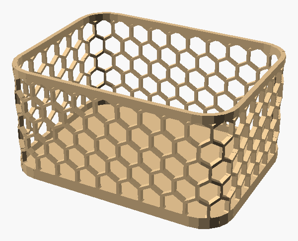 default: honeycomb, pattern runs round the corners</td><td align="center">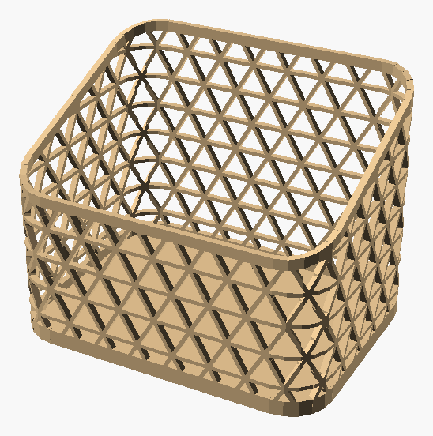 sloped rim, triangular lattice</td><td align="center">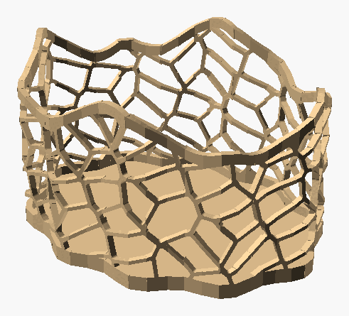 flowing outline, Voronoi, wavy rim</td></tr><tr><td align="center">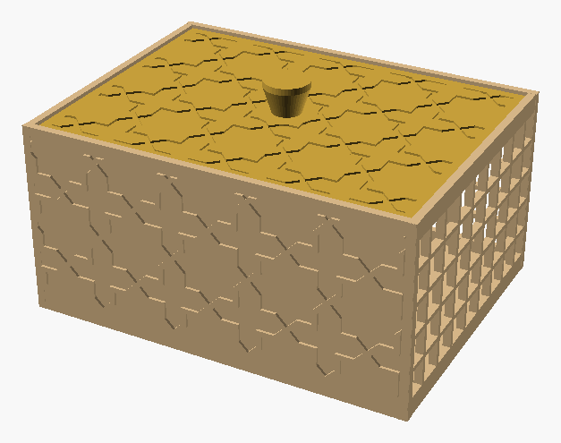 square, solid corners, inset lid with knob</td><td align="center">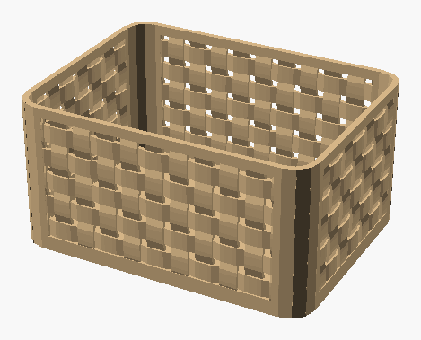 woven walls with solid corners</td><td align="center">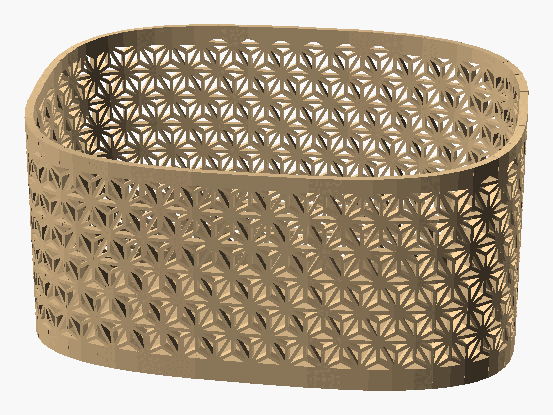 asanoha (hemp leaf) walls</td><td align="center">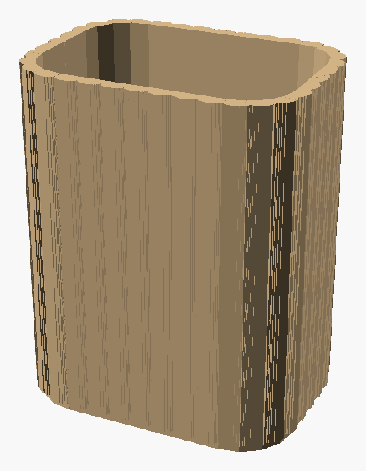 fluted pattern, reeded style: a ribbed vase</td><td align="center">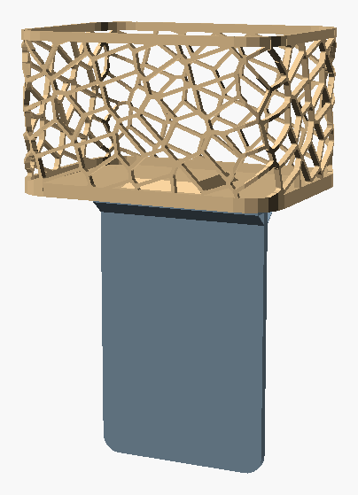 fin under the floor (sofa caddy)</td></tr><tr><td align="center">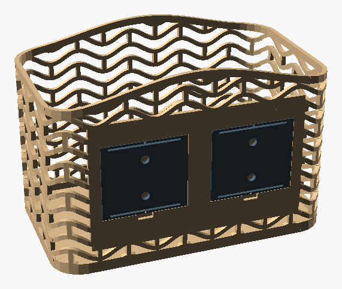 two wall plates, flush in solid zones of the back wall; wave pattern with ties</td><td align="center">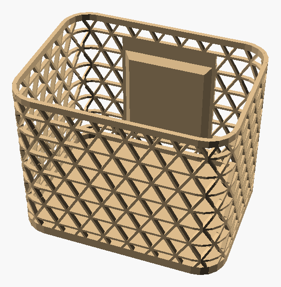 inside: the sloped pad that carries the socket depth</td></tr><tr><td align="center">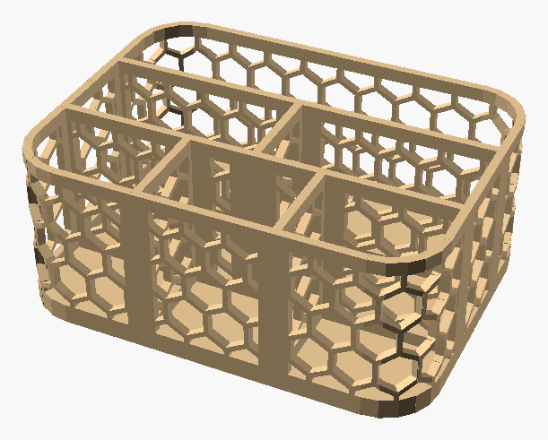 compartments: "33,33,33 / 50,50 / 100"</td><td align="center">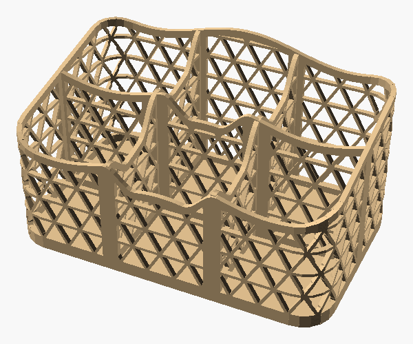 2 × 3 organizer: sloped, wavy rim, finger notches</td></tr></table>

**[Open the online configurator](https://tamaygz.github.io/tg_3d_modelling/custombox)** · or open `custombox_configurator.html` from this folder · [one-file model for MakerWorld](custombox_makerworld.scad) · [model](custombox.scad) · [print files](custombox_print) · [design log](custombox_log.md)

One model for any container: square and modern, round and flowing, or anything between. Outline, corners, rim,
walls, floor and lid are all settings, and every surface takes any of the 15 patterns from
[`lib/patterns.scad`](../../lib/README.md#patterns). Open `custombox_configurator.html` to design a box and download it.

| Group | Settings | What you get |
|---|---|---|
| Size | `width`, `depth`, `height` | outer size; `height` is the rim at the front left |
| Outline | `shape` (box / ellipse / squircle), `corners` (round / chamfer / square), `corner_r`, `squareness`, `side_wave`, `side_wave_count` | the footprint; `side_wave` swings the walls in and out for a flowing outline |
| Rim | `rise_front`, `rise_back`, `rise_left`, `rise_right`, `rim_wave_x_amp` / `rim_wave_x_count`, `rim_wave_y_amp` / `rim_wave_y_count`, `rim_wave_phase` | a sloped rim: raise or lower each wall; waves along it (`_amp` = how far the rim rises and falls, `_count` = how many waves) |
| Rim notches | `notch_front`, `notch_back`, `notch_left`, `notch_right` (depth), each with `_w` (width at half depth) | a dip in that wall's rim: a grip or a pouring lip |
| Compartments | `compart_rows`, `compart_cols`, `compart_layout`, `compart_sizes`, `compart_order`, `divider_t`, `divider_drop`, `divider_notch`, `divider_notch_w`, `divider_pattern`, `divider_mode` | divider walls: a plain grid, or your own layout in % per row; dividers match the walls they run along |
| Walls | `wall_t`, `wall_pattern`, `wall_mode`, `wall_cell`, `wall_strut`, `wall_angle`, `wall_seed`, `wall_relief`, `rim_band`, `base_band`, `corner_fill`, `post_w`, `fit_cells`, `front_pattern/_mode`, `back_pattern/_mode` | pattern and how it is applied: solid, through-cut, open lattice, raised, recessed, overlay |
| Floor | `floor_t`, `floor_pattern`, `floor_mode`, `floor_cell`, `floor_strut`, `floor_angle`, `floor_relief`, `floor_margin` | thickness (strength) and its own pattern |
| Lid | `lid` (none / inset), `lid_t`, `lid_pattern`, `lid_mode`, `lid_grip` (hole / knob / none), `lid_drop`, `lid_clearance` | a lid that drops onto a ledge inside the box |
| Mounting | `attach_type`, `attach_size`, `attach_count`, `attach_joint`, `slide_axis`, `fin_len`, `fin_w`, `fin_t` | snap-in plates (wall screws, keyhole, Skådis, hook, magnet, glue, ceiling, slide track) in a solid zone built into the back wall; a fin under the floor; optional ball joint |
| Pattern details | strand style, Voronoi rounding, honeycomb orientation, wave size, ripple spokes, `min_strut`, `min_opening`, `facet` | fine tuning and printability limits |

## Recipes

| Look | Settings |
|---|---|
| Honeycomb basket (default) | – |
| Sloped bin | `rise_back = 35; wall_pattern = "triangular_lattice"` |
| Wavy rim | `rim_wave_x_amp = 10; rim_wave_x_count = 1.5; height = 45` |
| Flowing organic bowl | `shape = "ellipse"; side_wave = 2.5; side_wave_count = 10; wall_pattern = "voronoi"; rim_wave_x_amp = 6; rim_wave_y_amp = 6; rim_wave_x_count = 2; rim_wave_y_count = 2` |
| Square modern box with lid | `corners = "square"; corner_fill = "solid"; wall_pattern = "square_grid"; front_pattern = "girih_star_cross"; lid = "inset"; lid_grip = "knob"` |
| Woven basket | `corner_fill = "solid"; wall_pattern = "basket_weave"; wall_mode = "open_lattice"; corner_r = 10` |
| Japanese hemp-leaf screen | `wall_pattern = "asanoha"; wall_cell = 10; wall_strut = 1` |
| Kumiko cubes | `wall_pattern = "cube_rosette"` (`cube_density = "all"` for tumbling blocks) |
| Reeded vase | `wall_pattern = "fluted"; wall_mode = "raised"; wall_relief = 1.5; rim_band = 0; base_band = 0` |
| Round can with a lining | `width = 80; depth = 80; corner_r = 40; wall_mode = "overlay"; wall_pattern = "girih_star_cross"` |
| Pegboard bin | `attach_type = "skadis"; corner_fill = "solid"; back_pattern = "hex_honeycomb"` |
| Sofa caddy for snacks and drinks | `attach_type = "fin"; fin_len = 150; fin_w = 100` (the blade goes down between two cushions) |
| Box on a rail | `attach_type = "slide"; attach_count = 2` |
| Tiltable box | `attach_type = "wall"; attach_joint = "ball"` |
| Organizer tray (3 + 2 + 1) | `compart_layout = "33,33,33 / 50,50 / 100"; height = 50` |
| Desk organizer with finger notches | `compart_rows = 2; compart_cols = 3; rise_back = 20; divider_notch = 14; notch_front = 14` |
| Narrow front row, deep back row | `compart_rows = 2; compart_cols = 4; compart_sizes = "30, 70"` |
| Columns of drawers' trays | `compart_order = "columns"; compart_layout = "50,50 / 25,25,25,25 / 100"` |

## How it works

- **Corners.** With `corner_fill = "pattern"` one pattern runs all the way round, through the corners; `fit_cells`
  nudges the cell size so a whole number of cells fits and there is no seam (the report shows the cell used).
  With `"solid"` the corners are plain and every wall is its own panel with the pattern centred on it; the front
  and back can then have their own pattern and mode.
- **Rim.** The top edge follows a height field over the floor plan (`shell_rim()` in lib/shell.scad): `height`,
  plus each wall's `rise_…` (it lifts that wall's rim and slopes back to 0 at the opposite wall; the four add up,
  so back 20 + right 10 makes the back right corner 30 mm higher), plus cosine waves across the width and the
  depth: `rim_wave_x_amp` is how far the rim rises and falls (mm), `rim_wave_x_count` how many waves fit across
  the width (the same for y). Notches dip one wall's rim in its middle with soft shoulders; a notch too deep for
  the floor and bands is made shallower (WARNING + report). The plain `rim_band` follows the rim with a constant
  height, and the pattern is clipped under it.
- **Compartments.** `compart_rows` × `compart_cols` gives a plain grid. For your own layout write one group per
  row in `compart_layout`, the compartments' sizes in % separated by commas and the rows by "/":
  `"33,33,33 / 50,50 / 100"` = three equal compartments in the front row, two in the middle row, one long one at
  the back. `compart_sizes` sets the rows' own depths (`"50, 25, 25"`, front to back). With
  `compart_order = "columns"` the groups are columns (left to right), each split from front to back. Sizes are
  shares: they do not have to add up to 100 (they are scaled), and the divider thickness is taken off first, so
  the compartments really have those proportions. Dividers along x look like the front / back walls, dividers along
  y like the sides (`divider_pattern`, `divider_mode` = "match"), or take a pattern of their own or none. They follow
  the rim (slopes, waves, notches), `divider_drop` lowers them, they stay under a lid, and `divider_notch` cuts a
  finger notch into each. Where they meet the walls or each other the pattern leaves a solid joint, and a solid
  strip in the floor runs under them. Compartments narrower than 8 mm are left out (WARNING + report).
- **Patterns that would fall apart** when cut through (Truchet arcs, ripples without spokes) are raised instead;
  the report line "wall pattern cut as asked" shows 0 when that happened.
- **Lid.** Only for a flat rim (no slope, no waves). It rests on a ledge that grows out of the wall at 45°, so the
  box still prints without supports. The report says whether the lid was fitted.
- **Mounting.** The back wall itself gets a solid zone for the sockets: the pattern stops at it and joins its
  sides, and the sockets are cut in from behind. The zone is flush with the inside face (nothing takes room from the
  box's content); what the 5.2 mm socket needs beyond the wall stands out behind it as a pad with 45° edges, and
  the plates sit flush with that pad. The zone runs into the rim or base band when they are close. It needs the box shape, a
  straight back (`side_wave = 0`) and a back wall as high as the plate. If the plates you ask for do not fit, fewer
  or smaller ones are used, or none: the render log shows a WARNING and the report says what was fitted.
- **Fin.** `attach_type = "fin"` puts the socket under the floor (any outline): the floor gets a solid zone, thickened
  upwards inside the box, and the slide plate under it rides on a track with a blade `fin_len` long. Slide the box
  onto the fin, push the blade between two sofa cushions. Print the fin standing on its end.
- **Slide track.** `attach_type = "slide"`: screw the track to the wall and slide the box on (horizontal), or drop it
  onto short vertical tracks.
- **Ball joint.** `attach_joint = "ball"` puts a lockable ball joint between the box and any plate type (about 37°
  tilt each way, 30 mm stand-off). Light loads only.
- **Line patterns** (flowing waves, ripples) get ties between their lines when they are cut through, so they
  print and stay stiff.

## Printing

- Print the box upright as modelled, the lid flat. No supports: lattice openings in the walls are bridged or
  self-supporting (honeycomb with corners up, diamonds and triangles are the easiest; wide square cells bridge).
- A wavy or sloped rim prints fine; the rim band keeps the top edge closed.
- Weaves on the walls are real over-under strands. Use `corner_fill = "solid"` with them: wrapped round the
  corners they work, but take several minutes to build in desktop OpenSCAD 2021.
- Curved outlines (ellipse, squircle, `side_wave`) are built from flat facets `facet` mm long.

Files: `custombox.scad` (model), `custombox_print/` (print files), `custombox_configurator.html`,
`tests.txt` (checked variants), `custombox_log.md`.
