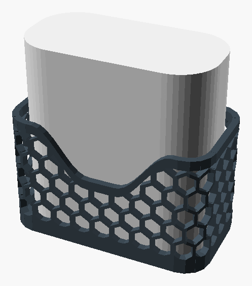
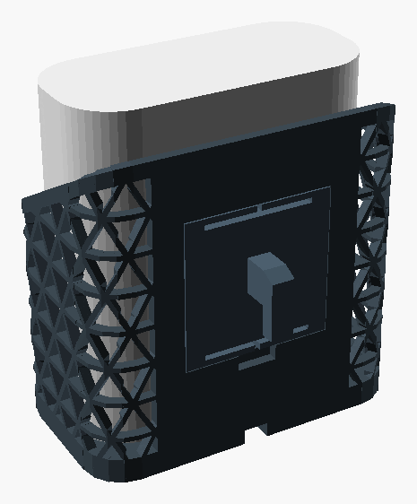
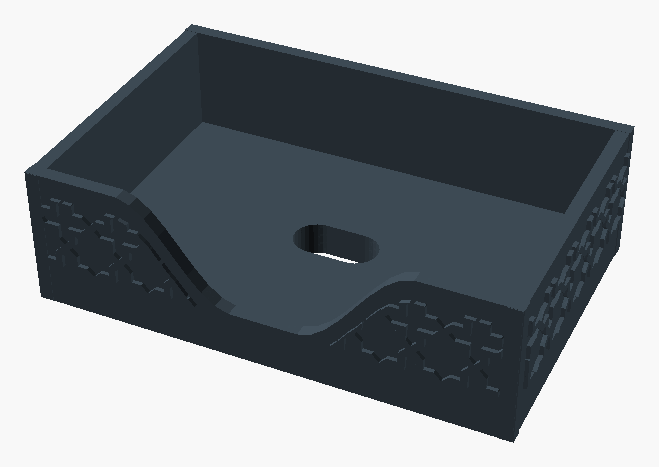

# Earbuds holder

<table><tr><td align="center"> Soundcore P31i case in its holder</td><td align="center"> Skådis plate in the back wall</td><td align="center"> flat pose with a plug dock</td></tr></table>

**[Open the online configurator](https://tamaygz.github.io/tg_3d_modelling/earbuds)** · or open `earbuds_configurator.html` from this folder · [model](earbuds.scad) · [print files](earbuds_print) · [design log](earbuds_log.md)

A dock for the charging case of your earbuds: it holds the case, lets the charging cable in, leaves a cut-out to
grab the case, and mounts with the snap-in attachment plates. Open `earbuds_configurator.html` to set it up.

| Group | Settings |
|---|---|
| Earbuds case | `preset`, `custom_size`, `pose` (upright / flat / side), `clearance`, `hold` |
| Walls | `wall_t`, `corners`, `corner_r`, `wall_pattern`, `wall_mode`, `wall_cell`, `wall_strut`, `wall_angle`, `wall_seed`, `wall_relief`, `rim_band`, `base_band`, `corner_fill`, `rise_back` |
| Front grip | `grip`, `grip_width`, `grip_depth` |
| Charging cable | `cable` (none / hole / dock), `cable_on` (floor / back / front / left / right), `cable_x`, `cable_y`, `plug_size`, `cable_d`, `cable_slot` |
| Floor | `floor_t`, `floor_pattern`, `floor_mode` |
| Mounting | `attach_type` (incl. `slide` track), `attach_size`, `attach_count`, `attach_joint` (ball joint), `slide_axis`, `fin_len`, `fin_w`, `fin_t` |

## Case sizes

Width × thickness × height of the closed case standing with its lid up. These are the makers' figures as far as I
could confirm them; cases have rounded shapes and tolerances, so measure yours and adjust `clearance` (0.6 mm per
side by default), or use `custom`.

| Preset | Size (mm) | Source |
|---|---|---|
| Soundcore P31i | 57.5 × 29.3 × 57.5 | Anker's Amazon listing (SoundGuys lists 57 × 27 × 57) |
| AirPods Pro 2 | 60.6 × 21.7 × 45.2 | Apple |
| AirPods 4 | 50.1 × 21.2 × 46.2 | Apple |
| Sony WF-1000XM5 | 64.6 × 26.5 × 40.0 | Sony |
| AirPods 2 | 44.3 × 21.3 × 53.5 | not re-checked: verify |
| Galaxy Buds2 Pro / FE | 50.1 × 27.7 × 50.2 | not re-checked: verify |
| Galaxy Buds3 Pro | 58.9 × 24.4 × 48.7 | not re-checked: verify |
| Bose QC Ultra Earbuds | 59.4 × 26.7 × 66.3 | not re-checked: verify |
| Pixel Buds Pro 2 | 65.0 × 25.0 × 49.9 | not re-checked: verify |
| Nothing Ear | 55.5 × 22.0 × 55.5 | not re-checked: verify |

## Notes

- **Pose:** `upright` holds the case as it stands on a desk; `flat` lays it on its back; `side` stands it on its
  short side. Check where the charging port of your case is and choose the pose and `cable_on` to match
  (P31i and most others: bottom, so `upright` + `floor`).
- **Cable:** `hole` lets the plug pass (1 mm play). `dock` makes the opening fit the plug body (0.15 mm play) so the
  plug is held and the case docks onto it: use a floor of 5 mm or more and set `plug_size` to your plug. With
  `cable_slot` the opening continues to the edge (floor: out through the foot of the back wall; wall: up to the
  rim), so the cable can be laid in. Every opening gets a plain collar.
- **Grip:** the front rim dips by `grip_depth` over `grip_width` with smooth shoulders; the rim band follows it.
- **Mounting:** the back wall gets a solid zone with the sockets, cut in from behind (the pattern joins its sides).
  Nothing stands out behind the holder; the extra thickness is a pad on the inside, and the holder is made that
  much deeper so the case still fits. `attach_type = "fin"` puts the socket under a thicker, flat floor instead and
  adds a blade to push between cushions; it needs 38 × 41 mm of floor, so it fits the `flat` pose but not a slim
  upright holder (then it is left out with a warning). The back wall must be at least 41 mm high for an S plate. If
  the plates you ask for do not fit, fewer or smaller ones are used, or none; the render log and the report say so.
  Raise `rise_back` to make room. A desk holder with a floor opening needs the cable to leave through the
  slot at the back.
- **Patterns** scale with the holder (`wall_cell = 0`); patterns that cannot be cut through are raised instead (see the report).
- The white block in the viewer is the case, for checking the fit; it is not printed.

Files: `earbuds.scad` (model), `earbuds_print/` (print files), `earbuds_configurator.html`, `tests.txt`, `earbuds_log.md`.
