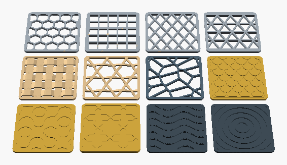
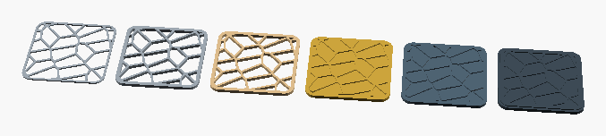
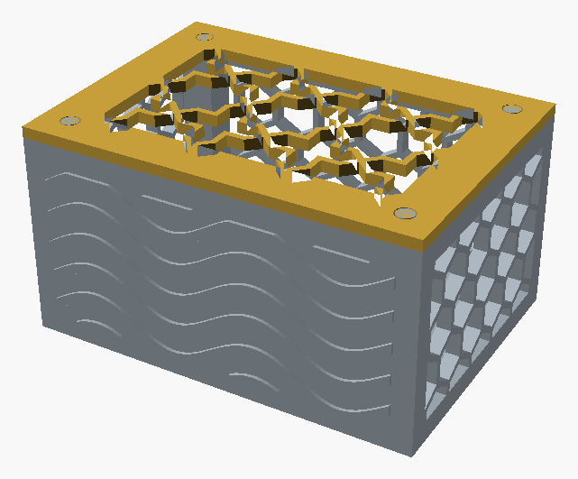

# Pattern gallery

<table><tr><td align="center"><br><sub>view gallery: all 12 patterns</sub></td><td align="center"><br><sub>view modes: one pattern alone and in every mode</sub></td><td align="center"><br><sub>view box: walls, front, floor and lid with their own patterns</sub></td></tr></table>

**[Open the online configurator](https://tamaygz.github.io/tg_3d_modelling/pattern_gallery)** · or open `pattern_gallery_configurator.html` from this folder · [model](pattern_gallery.scad) · [print files](pattern_gallery_print) · [design log](pattern_gallery_log.md)

Catalogue and test bench for the 12 parametric patterns in [`lib/patterns.scad`](../../lib/README.md#patterns).
Open `pattern_gallery_configurator.html` to try a pattern, change its settings and download the result.

| View | What it shows | Parts |
|---|---|---|
| `gallery` | all 12 patterns as equal tiles, each in its natural use | `g_<pattern>` |
| `sample` | one pattern in one mode on an outline you choose | `sample` |
| `modes` | one pattern alone and in every mode side by side: through-cut, open lattice, raised, recessed, overlay | `m_flat`, `m_<mode>` |
| `box` | a small box: the walls, the front wall, the floor and the lid each have their own pattern and mode | `box`, `lid` |

| Group | Settings |
|---|---|
| Pattern | `pattern`, `mode`, `cell`, `cell_y`, `strut`, `angle`, `density`, `offset_x/y`, `seed`, `min_strut`, `min_opening` |
| Sample | `sample_w`, `sample_h`, `sample_shape`, `thickness`, `relief`, `border`, `pad`, `relief_profile` |
| Overlay / lining | `lining_t`, `lining_mode`, `lining_inset`, `lining_edge` |
| Pattern details | one or more settings per pattern: orientation, stagger, strand style and lift, Voronoi irregularity / rounding / minimum cell, scale overlap / curvature, Truchet variation, star size, wave amplitude / length / shift, ripple rings / spokes / falloff / second centre |
| Gallery | `tile`, `tile_gap` |
| Box demo | `wall_pattern`, `wall_mode`, `front_pattern`, `front_mode`, `floor_pattern`, `floor_mode`, `roof_pattern`, `roof_mode`, sizes and thicknesses |

## The patterns

| Pattern | Family | In the gallery as | `cell` means | `strut` means |
|---|---|---|---|---|
| `hex_honeycomb` | lattice | open lattice | centre-to-centre distance of the cells | rib width |
| `square_grid` | lattice | open lattice | pitch (x, y) | rib width (vertical, horizontal) |
| `diamond_lattice` | lattice | open lattice | diamond width, height | rib width |
| `triangular_lattice` | lattice | open lattice | triangle side | rib width |
| `basket_weave` | woven (3D) | open lattice of real strips | strip pitch | strip width |
| `tri_weave` | woven (3D) | open lattice of real strands | distance between parallel strands | strand width |
| `voronoi` | organic | open lattice | average cell size | wall width |
| `fish_scales` | decorative | raised shingles | scale width, height | line width of the scale edges |
| `truchet_arcs` | decorative | engraved | tile size | arc width |
| `girih_star_cross` | decorative | perforated overlay on a solid panel | repeat spacing | strap width |
| `flowing_waves` | relief | raised ribs with rounded tops | rib pitch | rib width |
| `concentric_ripples` | relief | raised rings, lower towards the outside | ring spacing | ring width |

## Using a pattern in your own project

```scad
use <../../lib/patterns.scad>

// 1. the bare pattern (2D), to use like any other shape
linear_extrude(1) pattern_2d("hex_honeycomb", [100, 80], cell=12, strut=1.5, angle=15);

// 2. a whole panel from an outline: pick a mode
pattern_panel("open_lattice", "voronoi", [100, 80], t=2.4, border=3) circle(d=80);            // lattice in a ring
pattern_panel("raised", "fish_scales", [100, 80], t=2, depth=1.2);                             // relief on a slab
pattern_panel("recessed", "truchet_arcs", [100, 80], t=3, depth=0.6, seed=4);                  // engraved
pattern_panel("overlay", "girih_star_cross", [100, 80], t=2, lining_t=0.8, pad=2);             // lining on a slab

// 3. decorate a part you already have: cut or add at its surface (z = 0, outside = +Z)
difference() {
    translate([0, 0, -3]) linear_extrude(3) square([100, 80], center=true);                    // your wall
    pattern_cutter("hex_honeycomb", [100, 80], depth=3.1, pad=4, cut="cells");                 // through-cut
}

// 4. walls, floor and roof with their own patterns
wall  = pattern_spec("basket_weave", cell=10, strut=7);
floor = pattern_spec("concentric_ripples", cell=6, strut=2, opts=[["falloff", 0.5]]);
roof  = pattern_spec("hex_honeycomb", cell=12, strut=1.5);
pattern_panel("raised", floor, [70, 50], t=2, depth=0.8);                                      // floor, flat
translate([0, -25, 20]) rotate([90, 0, 0]) translate([0, 0, -2.4])                             // front wall, stood up
    pattern_panel("open_lattice", wall, [70, 40], t=2.4, border=3);
translate([0, 0, 40]) pattern_panel("through_cut", roof, [70, 50], t=2, border=4);             // roof
```

The `box` view of this project is exactly case 4 (`box_panel()` and `box_body()` in `pattern_gallery.scad`).

## Notes

- **Printability:** every module checks the pattern against `min_strut` (0.8 mm) and `min_opening` (1 mm) and stops with
  a message that says what to change. Nothing is adjusted silently. Set the limits for your nozzle.
- **Loose pieces:** Truchet arcs and plain ripples do not form one network, so they cannot be cut through or stand
  alone as a lattice (the model says so). Give ripples `ripple_spokes` to tie the rings together.
- **Weaves** print flat without supports: a strand that passes over rests on the strand below. Strands share
  15% or more of their thickness at each crossing, so the weave is one solid. A closed weave (`strut` = `cell`) is fine.
- **Speed:** lattices and reliefs build in seconds. Weaves take longer in desktop OpenSCAD 2021 (about 15–40 s for a
  100 mm panel, more with rounded strands); the browser configurator is much faster.
- Vertical holes in walls print as bridges: honeycomb with corners up, diamonds and triangles need none.

Files: `pattern_gallery.scad` (model), `pattern_gallery_print/` (print files), `pattern_gallery_configurator.html`,
`tests.txt` (checked variants), `pattern_gallery_log.md`.
