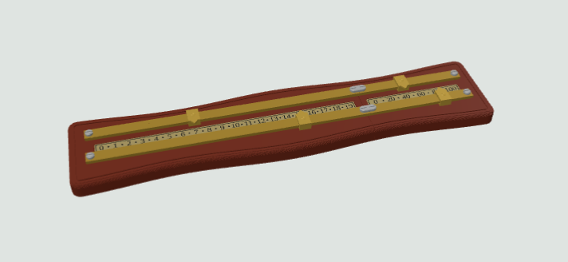
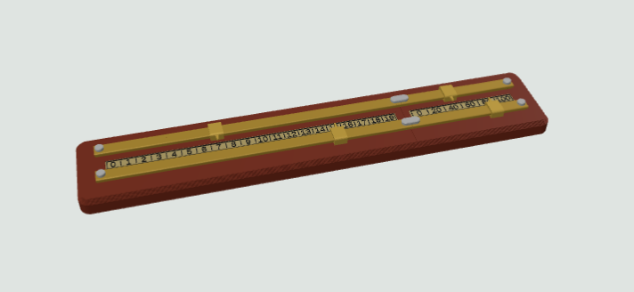
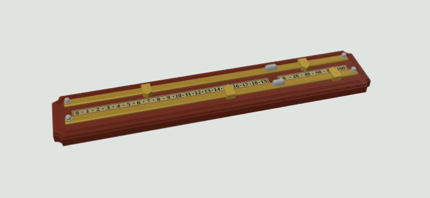
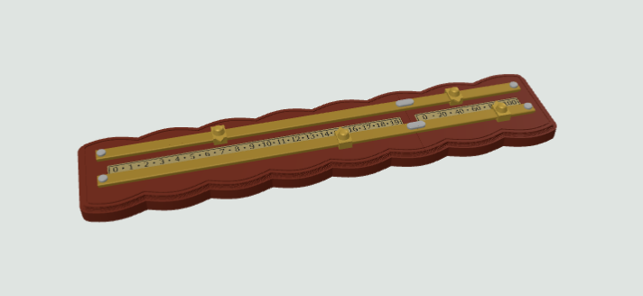
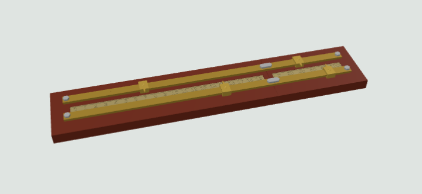

# Sliding-pin scoreboard (parametric)

Open `scoreboard.scad` in OpenSCAD from inside this repo: it uses the shared `../../lib` folder.
The Customizer panel (Window → Customizer) shows every setting below with dropdowns.
Set `part = "board_l"` (or any id below) and press F6 → Export STL to export a single part.

## Files
- `scoreboard.scad`: the model (needs `../../lib`)
- `scoreboard_print/`: print-ready STL/3MF files, oriented for printing
- `scoreboard_parts/`: each part as an STL in its assembled position
- `scoreboard_1c3546f.zip`: complete bundle (model, lib, print files, viewer), revision 1c3546f
- `scoreboard_configurator.html`: change the parameters in your browser, regenerate the 3D view and download STLs (internet needed for the OpenSCAD engine)
- `scoreboard.html`: interactive 3D viewer of the default build

## Main parameters
| Parameter | Default | Meaning |
|---|---|---|
| `players` | 2 | number of tracks; two tracks share one number plate (odd count = last plate has one track) |
| `base_min`, `base_max` | 0, 19 | main score range |
| `steps` | [20,40,60,80,100] | second-dimension steps; `[]` = no second column (one rail, one slider per player, no divider) |
| `zero_step` | true | "0" home position before the steps (ignored when `steps = []`) |
| `pitch`, `step_pitch` | 11, 14 | spacing of the numbers (mm), which sets the board length |
| `split_board` | true | cut the board at the divider into two halves joined by dowels |
| `demo_scores` | [[7,2],[15,4]] | where the sliders sit in the preview only |

## Styles

Pick a `style_preset`, or leave it on `custom` and set each style yourself:

| Setting | Options |
|---|---|
| `board_shape` | rect, rounded, chamfered, notched, arched, wave, scalloped |
| `edge_profile` | flat, roundover, chamfer, cove, ogee (classic router-bit profiles) |
| `groove_style` | none, single, double |
| `marker_style` | block, rounded, arrow, knob |
| `pointer_style` | triangle, needle, none |
| `stopper_style` | screw, dome, flat, hex, ball |
| `rail_style` | flat, rounded, beveled |
| `plate_style` | inlay (2-colour), raised, engraved (1 colour) |
| `font_style` | serif, serif bold, sans, sans bold |
| `separator` | dot, bar, diamond, none |

| Preset | Look |
|---|---|
| classic (default) | the reference photo: wave board, roundover, block markers, screw heads, inlaid serif numbers |
| modern | rounded board, chamfer, rounded markers with needle pointers, flat heads, raised sans numbers, bar separators |
| victorian | notched corners, ogee edge, double groove, arrow markers, ball stoppers, bold serif, diamonds |
| pub | scalloped edge, cove, knob markers, dome stoppers |
| minimal | plain rectangle, no profile, hex stoppers, numbers engraved in one colour |

## Mounting (attachment plates)

The board's back has sockets for the shared attachment plates (see [`lib/README.md`](../../lib/README.md)).

| Setting | Default | Meaning |
|---|---|---|
| `attach_type` | keyhole | none, wall, keyhole, skadis, hook, magnet, stand, flat, roof |
| `roof_gap`, `roof_angle` | 10, 90 | roof: gap from the board's top edge to the ceiling; angle between board and ceiling |
| `attach_size` | M | S 30×30, M 45×40, L 60×50 mm. The board must be tall enough (L needs 2 players' height) |
| `attach_count` | 2 | 1–4 plates, spread over the back and kept clear of the split dowels. Skådis keeps them on the 40 mm grid |

Push a plate straight into its socket until it clicks; lever it out with a flat screwdriver in the notch
below it. For wall and keyhole plates, screw the plates to the wall first, then press the board onto them. The socket ceilings print as 40–65 mm bridges,
so check your slicer's bridging settings.

## Parts (ids)
`board_l`, `board_r`, `plate_u`/`text_u`, `plate_s`/`text_s` (number plate + black inlay, 2-colour 3MF),
`rail_u`, `rail_s` (one of each per player), `slider` (2 per player: one for points, one for steps),
`stop_end` (2 per player), `stop_div` (1 per player), `dowel`, `attach` (one per socket).

## Assembly
1. Glue the board halves together with the dowels. Press or glue the number plates into their pockets.
2. Lay a main rail and a step rail on each track. They meet at the divider.
3. Press one `stop_end` peg through each outer rail end into the board.
4. Slide one slider onto each rail from the joint end, with the pointer facing the number plate.
5. Press the `stop_div` divider in across the joint. It locks both rails and separates the two sliders.
The peg shafts are an H7/p6 press fit; add a drop of glue if your printer prints holes oversize.
Hang the board from the two keyhole slots on the back.
