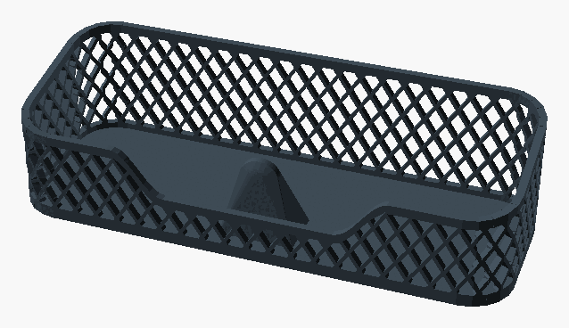
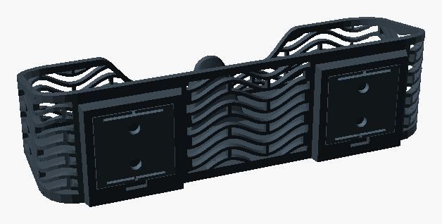
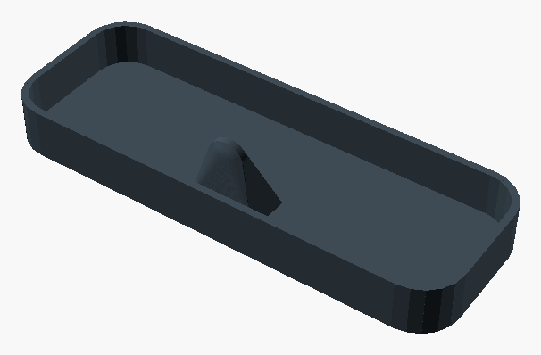

# Sunglasses holder

<table><tr><td align="center"> default</td><td align="center"> two wall plates, each in its own solid zone</td><td align="center"> the nose ridge: sloped and domed</td></tr></table>

**[Open the online configurator](https://tamaygz.github.io/tg_3d_modelling/sunglasses)** · or open `sunglasses_configurator.html` from this folder · [model](sunglasses.scad) · [print files](sunglasses_print) · [design log](sunglasses_log.md)

A tray for folded glasses with a nose support, a cut-out at the front to take them out, patterned walls and the
snap-in attachment plates for the wall, a pegboard or a shelf edge. Sister project of [earbuds](../earbuds):
same construction, without the cable opening. Open `sunglasses_configurator.html` to set it up.

| Group | Settings |
|---|---|
| Glasses | `preset` (standard / small / aviator / oversized / sport wrap / custom), `custom_size`, `clearance`, `hold` |
| Nose support | `nose`, `nose_w`, `nose_foot`, `nose_h`, `nose_len`, `nose_setback`, `nose_run_front`, `nose_run_back`, `nose_crown` |
| Walls | `wall_t`, `corners`, `corner_r`, `wall_pattern`, `wall_mode`, `wall_cell`, `wall_strut`, `wall_angle`, `wall_seed`, `wall_relief`, `rim_band`, `base_band`, `corner_fill`, `rise_back` |
| Front grip | `grip`, `grip_width`, `grip_depth` |
| Floor | `floor_t`, `floor_pattern`, `floor_mode` |
| Mounting | `attach_type` (incl. `slide` track), `attach_size`, `attach_count`, `attach_joint` (ball joint), `slide_axis` |

| Preset | Width × folded depth × lens height (mm) |
|---|---|
| standard | 148 × 48 × 50 |
| small | 130 × 42 × 42 |
| aviator | 142 × 46 × 56 |
| oversized | 156 × 54 × 62 |
| sport wrap | 152 × 64 × 48 |

These are typical values, not a standard: measure your glasses folded (widest point, front to back, lens height).

## Notes

- **Nose support:** a rounded ridge behind the front wall. The glasses sit with the lenses to the front and the
  bridge over the ridge. Set `nose_h` to the height of the bridge above the lower lens edge to carry the glasses
  (lenses clear of the floor), or lower to just keep them centred. `nose_w` is the top width (the gap between the
  nose pads is usually 14–20 mm), `nose_foot` the width on the floor. `nose_run_front` / `nose_run_back` slope the
  front and back faces (how far the top is set in from the foot) and `nose_crown` domes the top along its length,
  so the glasses slide up and off the ridge instead of hooking behind it. The ridge only rises from the floor and
  stays inside the walls, however wide or low you make it.
- **Grip:** the front rim dips by `grip_depth` over `grip_width`; the rim band follows it.
- **Mounting:** the back wall gets a solid zone with the sockets, built into the wall (the pattern joins its sides;
  no separate plate behind it); the back wall must be at least 41 mm high for an S plate
  (`rise_back` raises it). If the plates you ask for do not fit, fewer or smaller ones are used, or none; the render
  log and the report say so.
- The largest presets are close to 165 mm wide: fine for a 250 mm bed.

Files: `sunglasses.scad` (model), `sunglasses_print/` (print files), `sunglasses_configurator.html`, `tests.txt`, `sunglasses_log.md`.
